<p align="center">
  
</p>

<h1 align="center">SportSouq</h1>

<p align="center"><strong>Gear Up. Play Better.</strong><br />A sports e-commerce frontend built for customers in the United Arab Emirates.</p>

---

## Contents

- [Project Overview](#project-overview)
- [Key Features](#key-features)
- [Technologies Used](#technologies-used)
- [Project Screenshots](#project-screenshots)
- [Requirements](#requirements)
- [Installation and Setup](#installation-and-setup)
- [Environment Configuration](#environment-configuration)
- [Database Configuration](#database-configuration)
- [How to Run the Project](#how-to-run-the-project)
- [Project Structure](#project-structure)
- [Important Modules](#important-modules)
- [API Documentation](#api-documentation)
- [Security Notes](#security-notes)
- [Future Improvements](#future-improvements)

---

## Project Overview

SportSouq is an online sports store for the UAE market. Shoppers can browse ten sports, filter and compare products, manage a cart and wishlist, check out with UAE delivery options, and track their orders. Store staff manage the catalogue, orders, coupons and reviews from an admin dashboard.

Prices are in **AED**. Delivery estimates are calculated per emirate, with same-day delivery in Dubai for orders placed before 14:00. Cash on Delivery is available across the UAE, and VAT (5%) is shown as a separate line at checkout.

The project is **frontend-only**. It has no server or database. Instead, an in-browser mock REST API is plugged into Axios as a custom adapter, and its data persists in `localStorage`. Every component talks to the service layer rather than to the mock directly, so a real backend can be connected later through environment variables alone.

---

## Key Features

**Storefront**

- Homepage with hero, shop-by-sport, flash deals with countdown timers, best sellers, new arrivals, featured sports, shoe and sportswear collections, UAE offers, testimonials and a newsletter signup
- 100 products across 10 sports and 12 categories, plus 5 collection pages
- Product variants (size, colour, fit, configuration); the selection updates price, stock, SKU and image
- Combined filters kept in the URL: sport, category, type, brand, price, rating, size, colour, gender, age group, availability and discount
- Sport-specific filters: football boot type and surface, cricket bat type and size, running type, racket weight, fitness equipment type
- Seven sort orders, pagination, live facet counts, and a filter bottom sheet on mobile
- Global search with debounced suggestions, recent and popular searches, product previews and a no-results state
- Product page with gallery (thumbnails, hover zoom, swipe, fullscreen), sport-aware specifications, delivery estimate per emirate, reviews, and four recommendation rows (related, frequently bought together, recommended, recently viewed)
- Quick View modal

**Cart and checkout**

- Mini-cart drawer and cart page with save-for-later and quantity limits based on stock
- Prices and stock re-checked against the catalogue when the cart opens
- Coupon engine: percentage, fixed and free-delivery coupons, with minimum order, expiry, first-order-only, sport restrictions and usage limits
- Six-step checkout: Contact → Address → Delivery → Payment → Review → Confirmation
- UAE address form (emirate, city, area, building/villa, unit, street, landmark, Home/Office label)
- Simulated payments: card, Apple Pay and Cash on Delivery, including a declined-card path

**Customer account**

- Dashboard, profile and password change
- Order history with status filters; order details with a tracking timeline, cancel and buy-again
- Saved addresses with a default address; wishlist; settings for theme, default emirate, notifications and privacy

**Admin dashboard (`/admin`)**

- KPIs (revenue, orders, customers, products, units sold, average order value) with change versus the previous period
- Analytics for Today, 7 days, 30 days, 3 months and 12 months, with Recharts charts that can be switched to a data table
- Product management (add, edit, delete, publish/unpublish), order status workflow, customers, categories and subcategories, per-variant inventory, coupon management, and review moderation (approve, reject, delete)

**Cross-cutting**

- Light and dark themes driven by one set of design tokens
- Responsive from 320px up to large desktop
- Accessibility: semantic landmarks, skip link, focus-trapped dialogs, keyboard-navigable menus, tabs and combobox, and labelled forms
- SEO: dynamic titles and meta descriptions, Open Graph tags, canonical URLs and Product JSON-LD
- Lazy-loaded routes and images; skeleton loaders, empty states, error states and toast notifications
- UI copy kept in a typed dictionary (`src/i18n/en.ts`) so Arabic and right-to-left layouts can be added later

---

## Technologies Used

| Area | Technology |
|------|------------|
| Framework | React 19, TypeScript 7 |
| Build tool | Vite 8 |
| Styling | Tailwind CSS 4 |
| Routing | React Router 7 |
| Data fetching / caching | TanStack Query 5, Axios |
| Forms and validation | React Hook Form, Zod 4 |
| Animation | Framer Motion |
| Charts | Recharts 3 |
| Icons | Lucide React, plus custom SVG sport, payment and social icons |
| Persistence | Browser `localStorage` / `sessionStorage` |

Exact versions are pinned in `package.json` and `package-lock.json`.

---

## Project Screenshots

All screenshots are taken from the running application and stored in `docs/screenshots/`.

### Storefront

**Homepage**: hero section, the sticky header with search, and the main navigation.

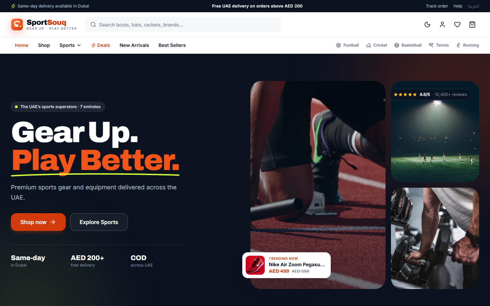

**Sport page**: sport banner with product stats, plus subcategory tiles for filtering by type.

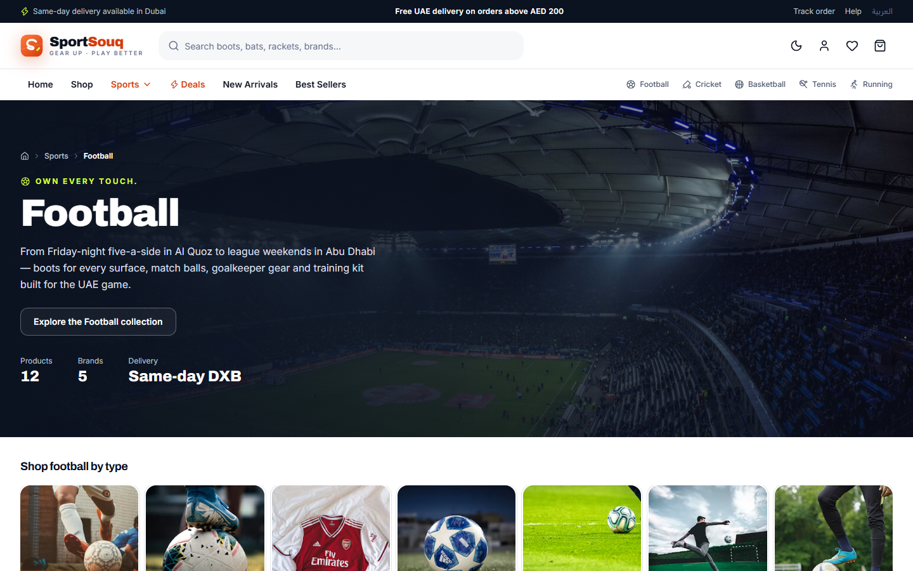

**Shop with filters**: the filter sidebar with live counts, active filter chips, sorting and product cards with badges.

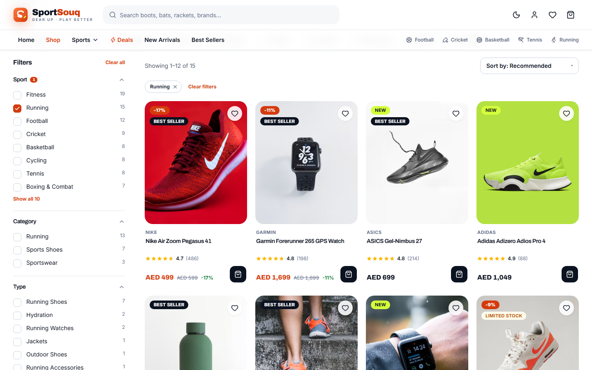

**Product page**: image gallery, variant selection (the SKU updates with size), AED pricing with discount, and the deal countdown.

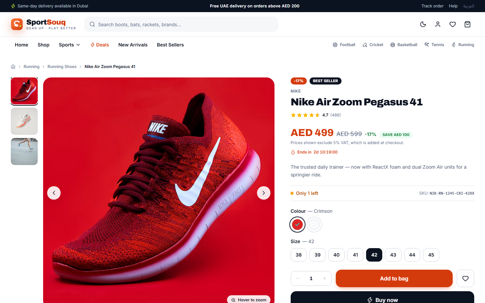

### Shopping flow

**Cart**: line items with a stock limit, a free-delivery progress bar, an applied coupon and an order summary with VAT shown separately.

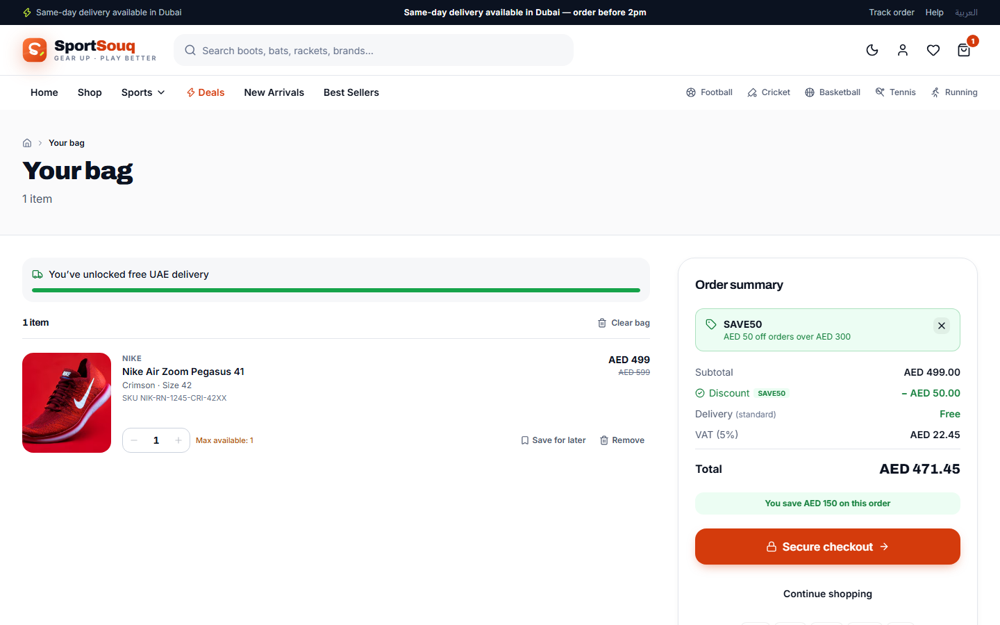

**Checkout**: the six-step checkout at the delivery step, showing Standard, Express and Same-Day options for Dubai with fees and estimated dates.

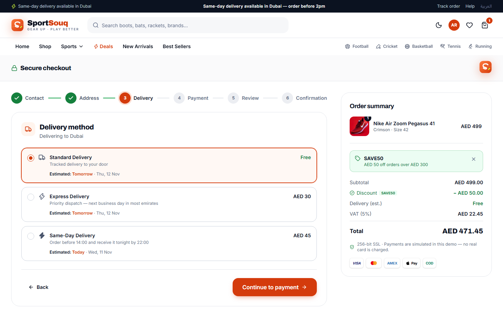

**Order tracking**: order details with the Confirmed → Processing → Shipped → Out for Delivery → Delivered timeline.

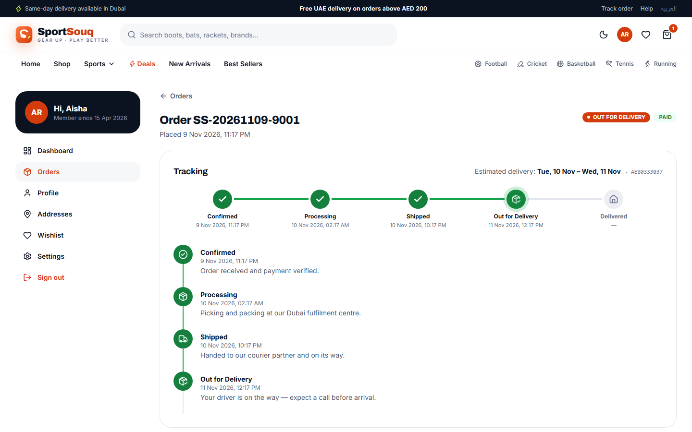

### Admin dashboard

**Dashboard**: KPI cards with change versus the previous period, plus revenue and orders charts.

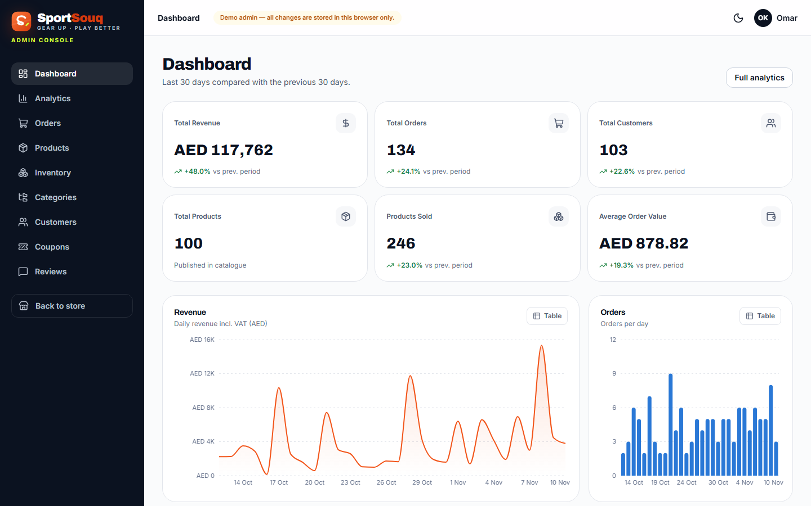

**Analytics**: date-range filters and the 12-month revenue trend. Each chart can be switched to a data table.

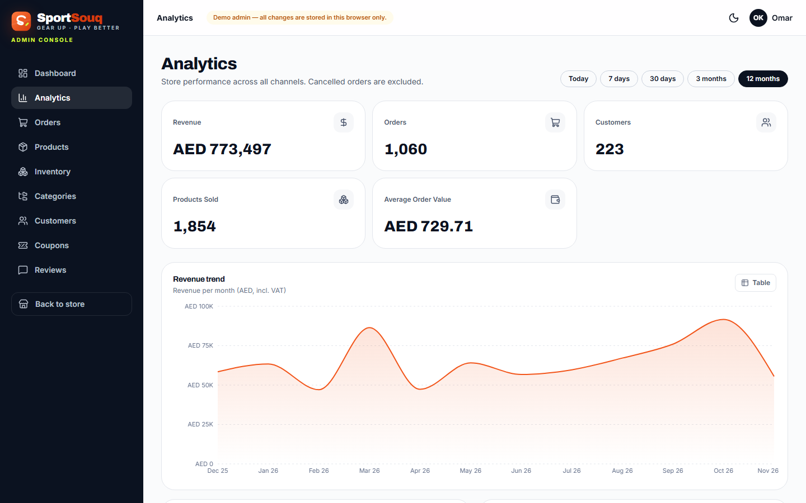

### Mobile and dark mode

<table>
  <tr>
    <td align="center" width="50%">
      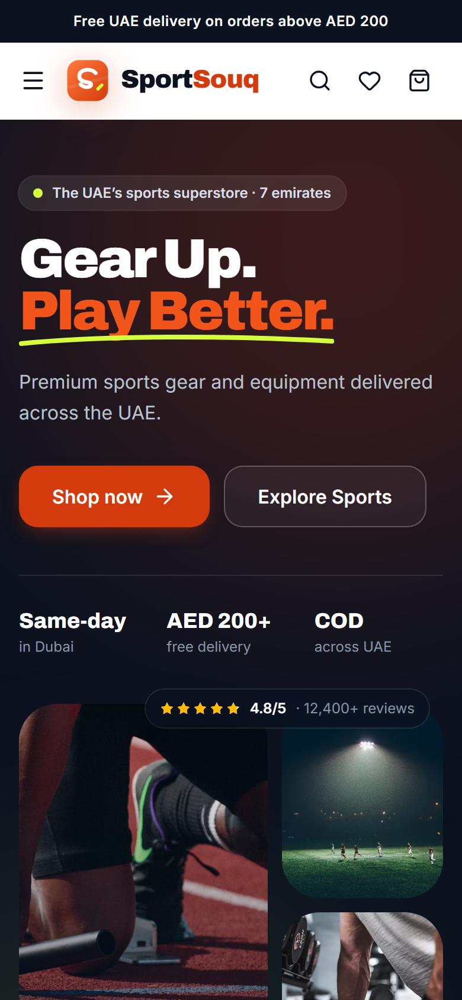<br />
      <sub>Homepage on mobile (390px)</sub>
    </td>
    <td align="center" width="50%">
      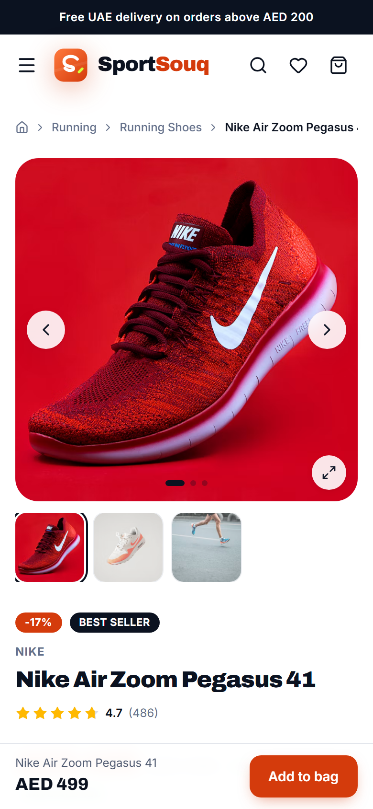<br />
      <sub>Product page on mobile, with the sticky Add to bag bar</sub>
    </td>
  </tr>
</table>

**Dark mode**: the shop page using the dark theme. The theme preference is saved in the browser.

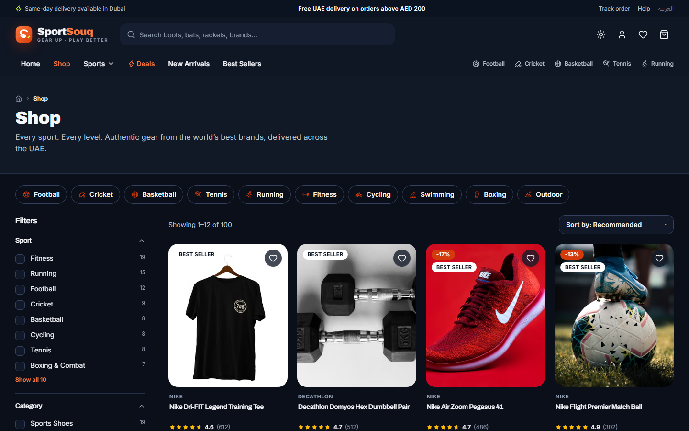

---

## Requirements

- **Node.js** `^20.19.0` or `>=22.12.0` (required by Vite 8)
- **npm** (the project uses `package-lock.json`)
- A modern browser (Chrome, Edge, Firefox or Safari)

There are no backend, database or external service requirements.

---

## Installation and Setup

```bash
# 1. Get the source code and enter the project folder
cd SportSouq

# 2. Install dependencies
npm install

# 3. (Optional) create a local environment file
cp .env.example .env
```

The application runs with default settings even without a `.env` file.

---

## Environment Configuration

All variables are optional. Only `VITE_`-prefixed variables are exposed to the browser, so never put secrets in them.

| Variable | Purpose | Default behaviour |
|----------|---------|-------------------|
| `VITE_BASE_PATH` | Base URL path when the app is deployed under a sub-folder | `/` |
| `VITE_USE_MOCK_API` | Set to `false` to send requests to a real API instead of the in-browser mock | Mock API enabled |
| `VITE_API_BASE_URL` | Base URL of a real REST API (used only when the mock is disabled) | Not used |
| `VITE_SITE_URL` | Public site URL used for canonical and Open Graph tags | `http://localhost:5173` |

Example `.env` (placeholder values):

```env
VITE_BASE_PATH=/
VITE_USE_MOCK_API=true
VITE_API_BASE_URL=https://your-api-domain.example
VITE_SITE_URL=https://your-site-domain.example
```

---

## Database Configuration

The current build does not use a database, so no setup, migrations or imports are needed.

- Seed data (products, categories, coupons, customers, orders and reviews) lives in `src/data/`. Customers, orders and reviews are generated deterministically when the app starts.
- Changes made while using the app are saved in the browser under `ss.*` `localStorage` keys. The mock database is stored under `ss.db.v1`.
- To reset the demo data, clear the site's storage in your browser's DevTools (Application → Storage → Clear site data).

The name `sportsouq` is reserved for a future backend database. When one exists, set `VITE_USE_MOCK_API=false` and point `VITE_API_BASE_URL` at it. The endpoint contract is listed under [API Documentation](#api-documentation).

---

## How to Run the Project

| Command | Description |
|---------|-------------|
| `npm run dev` | Start the development server at `http://localhost:5173` |
| `npm run typecheck` | Run the TypeScript compiler in strict mode |
| `npm run build` | Type-check, then create a production build in `dist/` |
| `npm run preview` | Serve the production build at `http://localhost:4173` |

### Demo accounts

A customer account and an admin account are preloaded in the mock auth store. On the **Login** page (`/login`), use the **Use Customer** or **Use Admin** button to fill in the demo credentials. The customer account includes an order history covering every delivery status, plus saved addresses.

### Payments and coupons

Payments are simulated and nothing is charged. The card step shows a test-card hint, including a card number that triggers a declined payment. Active coupon codes appear under **Available offers** in the cart.

### Deploying to Apache (e.g. WAMP)

```bash
VITE_BASE_PATH=/your-subfolder/ npm run build
```

Copy the contents of `dist/` to the web root. `public/.htaccess` is included in the build and rewrites client-side routes to `index.html`. It requires `mod_rewrite`.

---

## Project Structure

```
SportSouq/
├── docs/
│   └── screenshots/              # Application screenshots used in this README
├── public/
│   ├── .htaccess                 # SPA fallback for Apache
│   └── favicon.svg               # Logo mark
├── src/
│   ├── components/
│   │   ├── ui/                   # Design-system primitives (Button, Field, Modal, Drawer, Tabs, …)
│   │   ├── layout/               # Header, Footer, MobileNav, SearchBox, MainLayout
│   │   ├── product/              # ProductCard, Gallery, Filters, Listing, QuickView, Reviews, …
│   │   ├── cart/                 # CartDrawer, CartLine, OrderSummary / coupon form
│   │   ├── checkout/             # Checkout stepper and step components
│   │   ├── account/              # AddressForm, order status badges and timeline
│   │   ├── admin/                # Admin UI kit and Recharts wrappers
│   │   ├── sports/               # SportCard, SportBanner, SportCategory, SportFilters, …
│   │   └── common/               # Logo, Countdown, DeliveryPerks, section headings, icons
│   ├── pages/
│   │   ├── home/  shop/  sport/  category/  product/
│   │   ├── cart/  checkout/  account/  auth/
│   │   ├── admin/  info/  errors/
│   ├── context/                  # Auth, Cart, Wishlist, Checkout, Preferences, Toast, UI
│   ├── hooks/                    # Data hooks (TanStack Query) and utility hooks
│   ├── services/
│   │   ├── api/client.ts         # Axios instance and error helpers
│   │   ├── mock/                 # Mock adapter, router, persistent db, handlers
│   │   └── *Service.ts           # productService, orderService, couponService, …
│   ├── data/                     # Seed data and deterministic generators
│   ├── schemas/                  # Zod schemas shared by forms and the mock API
│   ├── utils/                    # Pricing/VAT, coupons, delivery dates, product query engine, …
│   ├── i18n/                     # Typed English dictionary and locale provider
│   ├── config/site.ts            # Emirates, delivery methods, VAT rate, storage keys
│   ├── routes/                   # Route table (lazy-loaded) and route guards
│   ├── types/                    # Domain types
│   ├── App.tsx                   # Providers and router
│   ├── main.tsx                  # Entry point
│   └── index.css                 # Tailwind import and design tokens
├── .env.example
├── index.html
├── package.json
├── tsconfig*.json
└── vite.config.ts
```

---

## Important Modules

| Module | Responsibility |
|--------|----------------|
| `src/index.css` | Design tokens: brand and neutral colour scales, semantic light/dark colours, fonts, shadows and radii |
| `src/utils/productQuery.ts` | Product filtering, search relevance scoring, sorting, facet counts and URL ↔ query conversion |
| `src/utils/pricing.ts` | Subtotal, discount, delivery fee, COD fee, VAT and total. One function is used by the cart, checkout and order creation |
| `src/utils/coupons.ts` | Coupon rule evaluation (valid, invalid, expired, inactive, minimum not reached, not applicable, first order only, limit reached) |
| `src/utils/delivery.ts` | Delivery quotes per emirate, the same-day cutoff, business-day maths and product delivery messages |
| `src/services/api/client.ts` | Axios instance with an auth header interceptor; switches between the mock adapter and a real API |
| `src/services/mock/` | Mock backend: route matching, simulated latency, a delta-persisted database and server-side validation |
| `src/context/CartContext.tsx` | Cart, save-for-later and applied coupon, persisted and synced across browser tabs |
| `src/context/CheckoutContext.tsx` | Checkout step state machine (`useCheckout()`); stores only non-sensitive payment metadata |
| `src/components/product/ProductListing.tsx` | Shared listing used by the shop, sport, category, collection, search, deals, new arrivals and best sellers pages |
| `src/routes/` | Lazy-loaded routes; `ProtectedRoute`, `AdminRoute` and `GuestOnlyRoute` guards |

---

## API Documentation

These endpoints are served by the in-browser mock API (`src/services/mock/handlers/`). They define the contract a future backend should implement. Authenticated endpoints expect an `Authorization: Bearer <token>` header.

**Catalogue**

| Method | Endpoint | Description |
|--------|----------|-------------|
| GET | `/products` | Filtered, sorted, paginated products with facets |
| GET | `/products/suggest` | Search suggestions and product previews |
| GET | `/products/:slug` | Product details |
| GET | `/products/:id/related` | Related products |
| GET | `/products/:id/bought-together` | Frequently bought together |
| GET | `/recommendations` | Personalised recommendations |
| GET | `/catalog/categories` | Categories and subcategories |

**Auth and account**

| Method | Endpoint | Description |
|--------|----------|-------------|
| POST | `/auth/login`, `/auth/register`, `/auth/logout` | Session management |
| GET | `/auth/me` | Current user |
| POST | `/auth/forgot-password` | Password reset request |
| PATCH | `/account/profile` | Update profile |
| POST | `/account/password` | Change password |
| GET / POST / PUT / DELETE | `/account/addresses[/:id]` | Address book |
| POST | `/account/addresses/:id/default` | Set the default address |

**Orders, coupons and reviews**

| Method | Endpoint | Description |
|--------|----------|-------------|
| POST | `/orders` | Place an order (prices, stock, coupon and delivery are re-validated on the server) |
| GET | `/orders`, `/orders/:id` | Order history and details |
| POST | `/orders/:id/cancel` | Cancel an order (allowed before it ships) |
| POST | `/coupons/validate` | Validate a coupon against the cart |
| GET | `/coupons/available` | Public active coupons |
| GET / POST | `/products/:id/reviews` | Reviews and summary; submit a review |
| POST | `/newsletter`, `/contact` | Newsletter signup and contact form |

**Admin** (admin role required)

| Method | Endpoint | Description |
|--------|----------|-------------|
| GET | `/admin/analytics` | KPIs and chart data for a date range |
| GET / PATCH | `/admin/orders`, `/admin/orders/:id/status` | List orders and update status |
| GET | `/admin/customers` | Customers with order totals |
| POST / PUT / DELETE / PATCH | `/admin/products[/:id][/status]` | Product management |
| PATCH | `/admin/inventory/:id` | Stock per variant and low-stock threshold |
| GET / POST / PUT / DELETE / PATCH | `/admin/coupons[/:code][/toggle]` | Coupon management |
| GET / PATCH / DELETE | `/admin/reviews[/:id]` | Review moderation |
| PUT | `/admin/categories` | Save categories and subcategories |

---

## Security Notes

This is a frontend-only application, so the measures below are scoped accordingly:

- **Passwords:** never stored in plain text. The mock auth layer keeps only a salted SHA-256 hash. A production backend should use a slow key-derivation function such as Argon2 or bcrypt on the server.
- **Payment data:** card numbers and security codes stay in the payment form state. Only the card brand and last four digits are kept. No real payment processing takes place.
- **Sessions:** stored as an opaque token with an expiry. Repeated failed logins are throttled, and forgot-password responses do not reveal whether an email is registered.
- **User input:** reviews, search terms and contact messages are sanitised before storage and always rendered as text. The code does not use `dangerouslySetInnerHTML`, and search highlighting splits strings rather than injecting HTML.
- **Redirects:** login and register redirects only accept in-app paths, which prevents open redirects.
- **Storage:** every `localStorage` read is validated, and corrupted or tampered values fall back to safe defaults.
- **Secrets:** the repository contains no API keys or secrets. Environment variables are public by design; keep secrets on a backend.

---

## Future Improvements

- Arabic translation and right-to-left layout (the i18n structure and direction switching are already in place)
- A real REST backend using the `sportsouq` database, plus a real payment gateway
- Automated unit and end-to-end test suites in the repository

---

<sub>Brand names and product photography (Unsplash, free licence) are used as demo data only. SportSouq is not affiliated with the brands shown.</sub>
